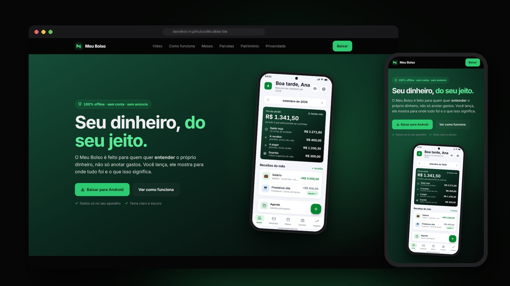
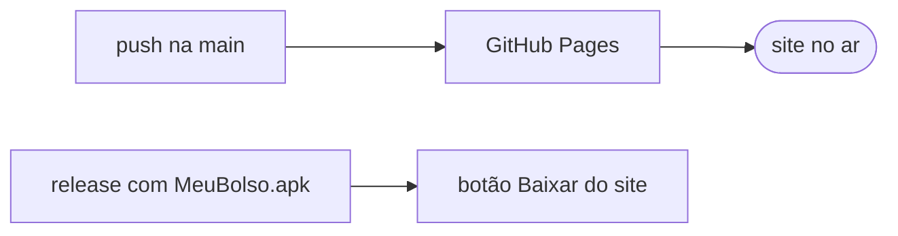

<div align="center">



<br />

[](https://otaviofelix-in.github.io/MeuBolso-Site/)
[](https://github.com/OtavioFelix-in/MeuBolso-Site/releases/latest)
[](https://github.com/OtavioFelix-in/MeuBolso-Site/releases)
[](https://pages.github.com/)

<br />

[**Abrir o site**](https://otaviofelix-in.github.io/MeuBolso-Site/)
&nbsp;&nbsp;·&nbsp;&nbsp;
[**Baixar o APK**](https://github.com/OtavioFelix-in/MeuBolso-Site/releases/latest/download/MeuBolso.apk)
&nbsp;&nbsp;·&nbsp;&nbsp;
[**Código do app**](https://github.com/OtavioFelix-in/MeuBolso)
&nbsp;&nbsp;·&nbsp;&nbsp;
[**Vídeo de 60 s**](https://youtube.com/shorts/s7te0wb4iUE)

<br /><br />

<a href="https://otaviofelix-in.github.io/MeuBolso-Site/">

</a>

</div>

<br />

## Sobre

Site promocional do **[Meu Bolso](https://github.com/OtavioFelix-in/MeuBolso)**, app de controle financeiro pessoal **100% offline**: sem conta, sem servidor e sem anúncio.

É uma página única, em HTML e CSS puros, **sem framework e sem build**. As fontes e a paleta são as mesmas do app, então o site e o app parecem uma coisa só.

## O que tem na página

<table>
<tr>
<td width="50%" valign="top">

**Apresentação**
- Abertura com o print da tela inicial do app
- Vídeo de apresentação de 60 s (YouTube, sem cookies)
- "Como funciona" em três passos

</td>
<td width="50%" valign="top">

**Funcionalidades**
- Seções de meses, parcelas, cartões e patrimônio, cada uma com o print real da tela
- Grade de relatórios e galeria de telas
- Bloco de privacidade

</td>
</tr>
<tr>
<td colspan="2">

**Download:** o botão aponta sempre para a **última release** deste repositório, com o passo a passo de instalação do APK logo abaixo.

</td>
</tr>
</table>

## Estrutura

| Arquivo | O que é |
|---|---|
| `index.html` | página única |
| `style.css` | estilos; tokens de cor da paleta escura do app e da logo |
| `assets/icon.png` | ícone do app (o mesmo de `assets/icon.png` do repositório do app) |
| `assets/icon-launcher.png` | `icon.png` recortado na área que o Android mostra; usado no favicon, no topo e no rodapé |
| `assets/telas/` | prints das telas |
| `assets/*.ttf` | Inter e Feather, as mesmas fontes do app |
| `docs/readme/` | banner e imagem de capa deste README (não vão para a página) |

## Rodar localmente

É HTML estático, sem build. Sirva a pasta com qualquer servidor, por exemplo:

```bash
npx serve .
```

## Publicação



- O **GitHub Pages** publica a branch `main`, pasta raiz. O que entra na `main` vai ao ar.
- O **APK** é publicado como asset `MeuBolso.apk` em uma release deste repositório.

> [!IMPORTANT]
> O arquivo da release precisa se chamar exatamente **`MeuBolso.apk`**: o botão do site baixa `releases/latest/download/MeuBolso.apk`.

---

<div align="center">


Feito por **Otávio Felix Da Silva**.

</div>
